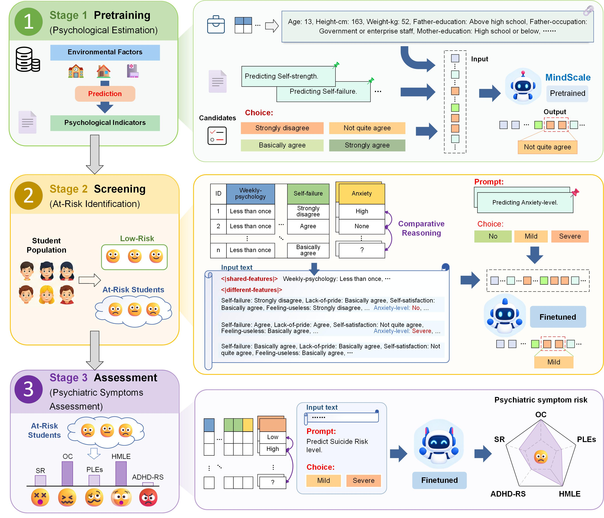

<a id="readme-top"></a>

<div align="center">
  <h1>MindScale</h1>
  <p><strong>A Psychometric Foundation Model for<br>Population-Scale Adolescent Mental Health Assessment</strong></p>
  <p>
    
    
    <a href="LICENSE"></a>
    <a href="https://huggingface.co/Rango001/Adolescent-mental-health"></a>
  </p>
  <p>
    <a href="#overview">Overview</a> &middot;
    <a href="#installation">Installation</a> &middot;
    <a href="#dataset-preparation">Data</a> &middot;
    <a href="#model-weights">Weights</a> &middot;
    <a href="#training">Training</a> &middot;
    <a href="#evaluation">Evaluation</a> &middot;
    <a href="#license">License</a>
  </p>
</div>

<a id="overview"></a>

## 📋 Overview

This repository contains the official implementation of **MindScale**.

- **Model**

  MindScale serializes structured questionnaire responses as text and adapts a
  LLaMA 3 backbone for population-scale adolescent mental health assessment.

- **Learning workflow**

  The framework follows three stages: pretraining, mental health screening,
  and psychiatric symptom assessment.

- **Code scope**

  This repository provides three-stage training and prediction export. Metric
  computation and the paper's plotting scripts are maintained separately.

<p align="right"><a href="#readme-top">⬆️ Back to top</a></p>

<a id="framework"></a>

## 🧩 Framework

<p align="center">
  
</p>

<p align="right"><a href="#readme-top">⬆️ Back to top</a></p>

<a id="installation"></a>

## 🛠️ Installation

- **Runtime:** CUDA-enabled Linux servers, with distributed execution through
  `torchrun`.

### Set Up the Environment

```bash
conda create -n mindscale python=3.8
conda activate mindscale
pip install -r requirements-core.txt
```

- **Dependencies:** `requirements-core.txt` contains the direct runtime
  dependencies. The original `requirements.txt` records the complete research
  environment.

- **Backbone access:** The LLaMA 3 checkpoint is gated on Hugging Face. Accept
  Meta's license and authenticate with Hugging Face before running the code.

<p align="right"><a href="#readme-top">⬆️ Back to top</a></p>

<a id="dataset-preparation"></a>

## 📂 Dataset Preparation

- **Data access:** The full participant-level cohort is not included in this
  repository. Use only appropriately authorized and de-identified questionnaire
  data.

- **Sample manifests:** Each manifest is a UTF-8 text file containing one
  relative JSON sample path per line. Paths are resolved relative to `data_path`.

- **Auxiliary manifests:** Screening and assessment use aligned files for
  school-stage labels and rarity-aware template-sampling weights. The default
  filenames are derived by prefixing the sample manifest name:

```text
train.txt          Sample paths
grade_train.txt    School-stage label for each training sample
mean_IP_train.txt  Sampling weight for each training sample
test.txt           Test sample paths
grade_test.txt     School-stage label for each test sample
```

- **Line alignment:** The three training files must be line-aligned with one
  another; the two test files must be line-aligned with one another. Training and
  test sets can have different sizes. Supply auxiliary paths explicitly with
  `--train_grade_file`, `--train_prob_file`, and `--test_grade_file` if needed.

- **School-stage labels:** Use `Primary school` or `Middle school` in the grade
  manifests. The latter includes the secondary-school cohorts.

### Sample Format

Each JSON sample contains `input` (observed key-value pairs) and `mask` (item
response records with `value` and `candidate`). This synthetic example shows
the screening target mapping under `label`:

```json
{
  "input": {"School-support": "Agree"},
  "mask": {
    "Self-satisfaction": {"value": "Agree", "candidate": ["Disagree", "Agree"]}
  },
  "label": {
    "anxiety": "No anxiety", "depression": "No depression",
    "satisfaction": "High life satisfaction", "stress": "No life stress"
  }
}
```

- **Stage-specific targets:** In the original samples, screening targets are
  stored in `label`, while assessment targets are stored in `re_label`. These
  fields are not interchangeable aliases. Assessment target keys are
  `re_suicidal`, `re_obsessive`, `re_psychotic`, `re_mania`, and `re_ADHD`.

- **Input-mode preparation:** The current comparative input builder reads
  targets from `label`; the non-comparative builder reads them from `re_label`.
  Prepare task-specific sample copies so that the selected stage's target
  mapping is available in the field required by that mode. Preserve auxiliary
  outcomes separately.

- **Label compatibility:** Valid label strings and their order are defined in
  `dataset_info.py`. Keep these strings unchanged when using released adapters.

### Template Sampling

`mean_IP_train.txt` contains one non-negative rarity weight per training sample,
with a positive total in each school-stage group. Compute weights from training
labels only, using the inverse product of marginal category frequencies. With
two templates, RCTS samples the first by these weights and selects the second
with maximum label Hamming distance; ties are sampled uniformly. Training labels
are cached once at dataset initialization for this selection.

<p align="right"><a href="#readme-top">⬆️ Back to top</a></p>

<a id="model-weights"></a>

## 🤗 Model Weights

- **Backbone · LLaMA 3-8B**

  The default backbone is
  [`meta-llama/Meta-Llama-3-8B`](https://huggingface.co/meta-llama/Meta-Llama-3-8B).
  Set `--model_name_or_path` to a local directory to use a downloaded checkpoint.

- **MindScale · LoRA adapters**

  The adapters are available in the
  [Hugging Face repository](https://huggingface.co/Rango001/Adolescent-mental-health),
  under `Pretrain/`, `Screen/`, and `Assessment/`.

### Download the Adapters

The following command downloads adapter files only:

```python
from huggingface_hub import snapshot_download

weights_dir = snapshot_download(
    repo_id="Rango001/Adolescent-mental-health",
    allow_patterns=["*/adapter_config.json", "*/adapter_model.safetensors"],
)
print(weights_dir)
```

| Stage | Subdirectory | LoRA rank | Alpha | Dropout |
| --- | --- | --- | --- | --- |
| Pretraining | `Pretrain` | 8 | 8 | 0.0 |
| Screening | `Screen` | 8 | 16 | 0.1 |
| Assessment | `Assessment` | 4 | 8 | 0.1 |

- **Released settings:** The defaults match the LoRA settings above. For other
  experiments, supply their original parameters and record the Hugging Face
  revision. These settings alone do not specify the full experimental protocol.

- **Stage dependencies:** Each downstream stage loads the preceding adapters.
  Pass the exact checkpoint directories through `--pretrain_state_dict_path`,
  `--screen_state_dict_path`, and `--assessment_state_dict_path`.

- **Checkpoint structure:** Earlier adapters remain active but frozen under
  distinct names. Only the current stage's `default` adapter is trained and
  saved, with its adapter files directly at the checkpoint root.

- **Earlier checkpoints:** The loader normalizes nested wrapper prefixes.
  Re-evaluate legacy checkpoints with the corrected stage activation. Optimizer
  continuation should use checkpoints created by this loader; older snapshots
  may have different parameter groups.

<p align="right"><a href="#readme-top">⬆️ Back to top</a></p>

<a id="training"></a>

## 🚀 Training

All stages use the same entry point. The examples below use one process; change
`--nproc_per_node` to the number of GPUs available on the server.

### 1. Pretraining

```bash
torchrun --standalone --nproc_per_node=1 main.py \
  --task_type Pretrain \
  --run_name pretrain \
  --data_path /path/to/pretrain/samples \
  --train_data_file /path/to/pretrain/train.txt \
  --test_data_file /path/to/pretrain/test.txt
```

### 2. Screening

```bash
torchrun --standalone --nproc_per_node=1 main.py \
  --task_type Screen \
  --run_name screen \
  --use_comparative_reason True --template_num 2 \
  --data_path /path/to/screen/samples \
  --train_data_file /path/to/screen/train.txt \
  --test_data_file /path/to/screen/test.txt \
  --pretrain_state_dict_path /path/to/pretrain/checkpoint
```

### 3. Psychiatric Symptom Assessment

```bash
torchrun --standalone --nproc_per_node=1 main.py \
  --task_type Assessment \
  --run_name assessment \
  --use_comparative_reason True --template_num 2 \
  --data_path /path/to/assessment/samples \
  --train_data_file /path/to/assessment/train.txt \
  --test_data_file /path/to/assessment/test.txt \
  --pretrain_state_dict_path /path/to/pretrain/checkpoint \
  --screen_state_dict_path /path/to/screen/checkpoint
```

<p align="right"><a href="#readme-top">⬆️ Back to top</a></p>

<a id="evaluation"></a>

## 📊 Evaluation

Add `--test_task True` and provide the checkpoint for the selected stage. The
historical sequential prompt construction is retained by default for result
reproducibility. To evaluate targets independently when context is disabled,
set `--legacy_eval_context_accumulation False`.

For example, evaluate the released screening adapters (replace `/path/to/weights`
with the directory printed above):

```bash
torchrun --standalone --nproc_per_node=1 main.py \
  --task_type Screen --test_task True \
  --use_comparative_reason True --template_num 2 \
  --data_path /path/to/screen/samples \
  --train_data_file /path/to/screen/train.txt \
  --test_data_file /path/to/screen/test.txt \
  --pretrain_state_dict_path /path/to/weights/Pretrain \
  --screen_state_dict_path /path/to/weights/Screen \
  --eval_results_folder screen-
```

- **Reference samples:** Downstream evaluation also needs the training manifest
  and its auxiliary files to select labeled reference samples.

- **Output location:** Predictions are written under
  `test_results/<eval_results_folder><checkpoint_name>/`, one JSON per sample.
  The `step-` prefix is removed from step-based checkpoint names.

| Output field | Meaning |
| --- | --- |
| `label` | Reference answer token sequences |
| `pred_token` | Selected label token sequences |
| `pred_probs` | Candidate scores indexed by the class order in `dataset_info.py` |

- **Output order:** Targets follow the question-prompt mapping in
  `dataset_info.py`. Decode token sequences with the prepared MindScale tokenizer.

- **Metrics:** Metric computation is separate from this entry point. Report AUC,
  macro-F1, balanced accuracy, per-class recall, and AUPRC.

<p align="right"><a href="#readme-top">⬆️ Back to top</a></p>

<a id="reproducibility"></a>

## 🔬 Reproducibility

- **Random seed:** The default seed is `42`.

- **Experiment records:** Record command-line arguments, GPU type, CUDA version,
  package environment, checkpoint path, and dataset version for each run.

<p align="right"><a href="#readme-top">⬆️ Back to top</a></p>

<a id="intended-use"></a>

## 📝 Intended Use

- **Research scope:** MindScale supports questionnaire-based population
  screening. Its outputs are not clinical diagnoses and must not replace
  assessment by qualified mental health professionals.

- **Responsible use:** Users are responsible for appropriate ethical approval,
  privacy protection, bias assessment, and human oversight.

<p align="right"><a href="#readme-top">⬆️ Back to top</a></p>

<a id="license"></a>

## 📄 License

- **Original code:** Released under the [MIT License](LICENSE).

- **Third-party components:** Retain their original licenses.

- **Backbone and adapters:** Remain subject to their applicable Meta Llama 3
  license and usage conditions.

<p align="right"><a href="#readme-top">⬆️ Back to top</a></p>
